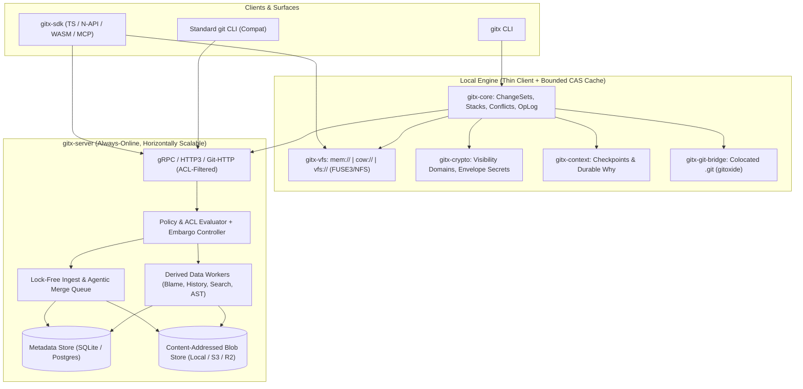

# GitX: Architecture & Implementation Plan (Rust)

## 1. Vision & Design Goals

**GitX** is a ground-up, Rust-native version control system and server platform designed for modern teams, large monorepos, and high-concurrency AI coding agents, while maintaining an incremental, lossless interoperability bridge with Git.

Git was built for the Linux kernel model—offline, decentralized, human-speed email patches where every collaborator with repository access is 100% trusted. GitX rethinks those assumptions from first principles:

| Limitation in Git / GitHub | GitX Architectural Solution |
| --- | --- |
| **100% or 0% repo-level access** (no private files, private branches, hidden PRs, or native `.env` secrets) | **Visibility Domains** (file, directory, branch/stack, and change-level ACLs) + **Domain-Partitioned Merkle Trees** + **Envelope-Encrypted Secret Domain** with key rotation & revocation |
| **No delayed disclosure** for security fixes (automated scanners turn public patches into instant 0-days) | **Embargoed Changes & Releases** that land, build, and distribute privately before promoting into the public timeline |
| **Clunky commits, staging areas, and fragile branches** | **Always-live working-copy snapshots (`@`)**, stable **`ChangeId`s**, immutable **OpLog** (`gitx undo`), and **native Stacked Diffs** with persisted revision interdiffs |
| **Modal merge-conflict limbo** (cannot save partial work or hand off half-resolved merges to an agent) | **First-class algebraic conflicts** stored inside ChangeSets; never blocks checkout, snapshot, or agent iteration |
| **Painful Git worktrees** (branch-locking hostages, slow APFS small-file duplication, bloated `node_modules`) | **Lock-free Workspaces** with 3 pluggable backends: **In-Memory VFS (`mem://`)**, **Copy-on-Write/Reflink (`cow://`)**, and **Lazy Virtual Mount (`vfs://`)** |
| **Decentralized full-clone overhead** (CI wasting hundreds of hours on `git checkout`, packfile GC) | **Always-online, client-server asymmetric architecture**: FastCDC + BLAKE3 blob storage, **zero-clone server RPCs** (`diff`, `blame`, `grep`, `land`), derived server indices |
| **No agent provenance or "why" context**; fragile IDE-only undo | Separate **`author` vs. `committer`** (human vs. agent/model/session), **sub-commit checkpoints**, and a **durable Context Store** anchored to AST/lines |
| **Split-brain merges, slow interactive CLIs, multi-machine `.env` drift, LFS hacks** | **ACID transactional landings** with O(1) atomic revert, **push-to-create**, **encrypted fleet sync** ("Dropbox for devs"), and native chunked large files (zero LFS) |

---

## 2. Core Architecture



---

### 2.1 Layered Merkle Trees & Visibility Domains

In Git, a commit hashes a single monolithic root tree. If `.env` or `packages/private/` exists in that tree, removing it later rewrites every commit hash in history, and standard clones fetch every reachable object.

GitX resolves this with **Domain-Partitioned Trees** and **Stable Public Projections**:

1. **Visibility Domains (`DomainId`):**
   - Every path pattern, stack, or ChangeSet belongs to a domain: e.g. `public`, `team:core`, `secret:prod`, `private:user:<id>`, or `embargo:<advisory-id>`.
   - Rules live in versioned `.gitxacl` manifests (evaluated hierarchically per path, with deny-by-default routing for secret patterns like `.env*`, `*.pem`, `*.key`).
2. **Partitioned Root Manifest per ChangeSet:**
   - A `ChangeSet` stores a map of domain-partitioned tree roots instead of a single monolithic root hash:
     ```rust
     struct ChangeSet {
         id: Blake3Hash,                      // Immutable revision hash
         change_id: ChangeId,                 // Stable ULID/UUIDv7 across amends/rebases
         parents: Vec<Blake3Hash>,
         public_projection_hash: Blake3Hash,  // Depends ONLY on `public` domain + public parents
         domain_trees: BTreeMap<DomainId, DomainTreeRef>,
         author: Identity,                    // Human initiator
         committer: Actor,                    // Human or Agent { harness, model, session_id }
         visibility: VisibilityPolicy,        // Domain + optional `embargo_until` / `reveal_on_land`
         conflicts: Option<ConflictSet>,      // First-class unresolved conflicts
         timestamp: i64,
         description: String,
     }
     ```
   - **Stable Public Projection invariant:**
     - Public clones, forks, and Git exports materialize *only* the `public` domain tree and public parent links.
     - Private filenames, private tree hashes, `.env` contents, and embargoed diffs **never enter the public Merkle graph**.
     - Open-sourcing a private repo (or rotating/modifying private files and secrets) **never rewrites public commit hashes**.
3. **Native Secret Management (`secret:*` domains):**
   - Secret blobs are **envelope-encrypted** using X25519/`age` (or KMS/hardware-backed keys) + ChaCha20-Poly1305: each secret file uses a per-epoch Data Encryption Key (DEK) wrapped individually for each authorized user, CI runner, or machine identity.
   - **Revocation & rotation:** Removing a user from `secret:prod` immediately blocks server fetches, drops their key wrap in the next key epoch, logs an audit entry, and outputs an exact exposure report of every secret version they decrypted so rotation is deterministic.
   - **Zero-trust secret guard:** Client + server pre-ingest scanning automatically routes detected secrets (`.env`, API tokens) into the repo's default `secret:dev` domain (or rejects unlabelled pushes to `public`).
4. **Delayed Disclosure / Embargoed Security Fixes:**
   - Maintainers create a change in `embargo:cve-2026-xxxx` scoped to `security-team` + `downstream-distros`.
   - CI builds and signs release artifacts directly from the embargoed ChangeSet.
   - When the embargo lifts (`gitx embargo publish <id>`), the server atomically promotes the sealed tree into `public`.

---

### 2.2 Storage Layer: FastCDC Chunking + Immutable Blobs (No Packfiles, No LFS)

- **Hashing:** BLAKE3 everywhere (multi-threaded, SIMD-accelerated, cryptographically strong).
- **Content-Defined Chunking (FastCDC):** Files > 64 KiB are split into content-defined chunks (64 KiB–256 KiB average) assembled via a Merkle B-tree (`ChunkedBlob`).
  - Handles source files, large binaries, ML weights, and media through **one unified primitive**—eliminating Git LFS.
  - Editing 100 bytes inside a 500 MB binary uploads only the affected chunk(s).
- **No Packfiles / No Repo GC:**
  - The server stores chunks in pluggable object storage (S3/R2/GCS/local FS) + metadata in Postgres/SQLite, served through an immutable tiered RAM/disk cache.
  - Clients keep a bounded LRU chunk cache (`~/.cache/gitx/cas`) shared across all repos and workspaces on the machine.

---

### 2.3 Developer Primitives: Snapshots, Stacks, Conflicts & OpLog

1. **Always-Live Working Copy (`@`) & No Staging Ceremony:**
   - File edits update the active anonymous working-copy ChangeSet (`@`) automatically on command/snapshot boundaries—no `git add` required.
   - Hunk-level splitting (`gitx split -p`) and squashing (`gitx squash`) remain first-class for organizing work *after* editing.
2. **First-Class Conflicts Inside ChangeSets:**
   - Merging or rebasing conflicting changes creates a valid `ChangeSet` whose tree entries hold structured **algebraic conflict terms** (`adds: Vec<BlobRef>, removes: Vec<BlobRef>`).
   - Partial conflict resolutions can be saved, shared with teammates, or handed off to an AI agent without trapping the repository in a broken modal `MERGE_HEAD` state.
3. **Native Stacked Diffs + Revision Interdiffs:**
   - Every logical change has a persistent `ChangeId` and an ordered history of immutable `Blake3Hash` revisions (`v1`, `v2`, `v3`…).
   - `gitx stack` / `gitx new` creates dependent changes; `gitx sync` pulls latest trunk, prunes landed changes, and automatically restacks open stacks from base up.
   - `gitx diff --interdiff` compares any two versions of a `ChangeId` across amends/rebases, eliminating the review pain of force-pushing.
4. **Immutable Operation Log (`OpLog`) & Sub-Commit Checkpoints:**
   - Every local or server mutation appends an atomic OpLog entry (`gitx op log`, `gitx undo`, `gitx op restore <id>`).
   - **Agent Checkpoints:** Before/after each agent turn, `gitx checkpoint` captures a lightweight CAS snapshot tagged with `{ agent, session_id, prompt_hash }`. Rolling back an agent step applies a **3-way inverse patch** against the current working copy so concurrent human edits are never clobbered.

---

### 2.4 Workspaces: Killing Git Worktrees (`gitx-vfs`)

A **Workspace** is simply a pointer to its own working-copy ChangeSet (`@ws-name`) plus a materialization backend. Multiple workspaces can sit on `main` or the same stack simultaneously—**no workspace ever holds a branch hostage**.

Three pluggable backends implement one Rust `WorkspaceBackend` trait:

1. **`mem://` (Zero-OS / In-Memory VFS):**
   - Pure Rust in-memory tree backed by the CAS cache. Zero disk writes, zero syscalls, sub-millisecond clone/branch/diff.
   - Exposed via Rust crate, TypeScript/N-API/WASM SDK, and MCP server for in-memory agent sandboxes and fast CI steps.
2. **`cow://` (Copy-on-Write / Reflink Local Workspace):**
   - Uses `FICLONE` (Linux XFS/Btrfs) or `clonefile` (macOS APFS) from a read-only local CAS materialization pool to avoid redundant small-file writes and disk bloat.
   - Supports shared workspace overlays (e.g., content-addressed hardlink/reflink hydration for `node_modules` or build caches) and defaults to latest remote trunk on creation.
3. **`vfs://` (Lazy Virtualized Mount):**
   - Linux `fuser` (FUSE3) and macOS NFSv3 loopback / FSKit mount that exposes the entire monorepo tree instantly (`<50 ms`) and materializes file blobs lazily on read, redirecting writes to a sparse local CoW overlay.
4. **Cross-Machine Fleet Sync ("Dropbox for Devs"):**
   - `gitx fleet sync` replicates a user's encrypted private overlays (`.env*`, configured gitignored files, and active anonymous WIP ChangeSets) across registered machines (laptop, Linux agent box, cloud sandbox) while automatically excluding OS/arch-specific artifacts (`node_modules`, `target/`).

---

### 2.5 Always-Online Server, Zero-Clone APIs & Agentic Merge Queue (`gitx-server`)

- **Push-to-Create & 1-Line Programmatic API:**
  - Pushing to an authorized namespace (`gitx push origin/my-new-app`) provisions the repository automatically with zero interactive prompts.
  - Programmatic SDK: `client.createRepo(...)`, `repo.commitFiles(...)`, `repo.createEphemeralWorkspace(...)`.
- **Zero-Clone RPCs (gRPC + HTTP/JSON):**
  - `GetTree`, `ReadBlob`, `Diff(a, b)`, `Blame(path, rev)`, `PathLog`, `Grep(regex, rev)`, `CreateChangeSet`, `Rebase`, `Land`, `Revert`.
  - CI jobs and coding agents inspect history, compute diffs, run targeted checks, and submit ChangeSets without cloning locally.
- **Derived Data Engine:**
  - Recursive server-side derived indices computed from parent ChangeSets:
    - `CommitGraphSkipList` (O(log N) ancestry & merge-base)
    - `PathHistoryIndex` & `BlameGraph`
    - `TrigramSearchIndex` (instant server-side `grep`)
    - `SymbolIndex` (Tree-sitter AST anchors for `gitx why`)
- **Lock-Free Ingest & Batched Agentic Landing:**
  - Uploading ChangeSets is lock-free (append-only CAS + metadata insert).
  - Landing to a protected target (`main`) runs through a **transactional CAS sequencer** with:
    1. **Structured & Semantic Auto-Merge:** Line merge + key-aware JSON/TOML/YAML merge + Tree-sitter AST merge (Rust, TS/JS, Python).
    2. **Batched Landing + Optional Agent Conflict-Resolver Hook:** Groups approved changes, lands them atomically, and optionally invokes a sandboxed agent hook to resolve mechanical conflicts before post-merge/pre-deploy checks.
    3. **Ironclad Persistence:** Every land is a single ACID commit with a monotonic `land_seq` and outbox webhook log (eliminating split-brain or silently reverted merges). `gitx revert <land_seq>` is O(1) and atomic.

---

### 2.6 Durable "Why" Context Store (`gitx-context`)

- Stores structured **Context Records** (`Prompt`, `AgentTrace`, `ReviewThread`, `DesignDecision`, `IssueLink`) in the same content-addressed store, inheriting **Visibility Domains** (internal prompts stay private even when code lands publicly).
- Anchors records using **triple-redundant locators** (`ChangeId` + AST symbol path + fuzzy hunk fingerprint) so `gitx why src/auth.rs:42` traces rationale across squashes, rebases, and refactors.

---

### 2.7 Lossless Git Interoperability Bridge (`gitx-git-bridge`)

Built on pure-Rust **`gitoxide` (`gix`)**:

1. **Colocated Local Mode (`gitx init --colocate`):**
   - Works alongside an existing `.git` directory so IDEs, scripts, and contributors using standard `git` remain uninterrupted.
2. **ACL-Filtered Git Smart HTTP/SSH Projection:**
   - `gitx-server` exposes standard Git Smart HTTP (`git-upload-pack` / `git-receive-pack`) dynamically projected for the caller's authenticated Visibility Domains.
   - Public `git clone` users receive a 100% valid Git repository containing *only* `public` trees and branches—zero leaked `.env` files, private branches, or embargoed patches.
3. **Bidirectional Mirroring:**
   - Optional async mirror worker to sync the `public` projection to GitHub, Forgejo, or GitLab.

---

## 3. Cargo Workspace Layout

```text
gitx/
├── Cargo.toml                  # Workspace manifest (Rust 2024 edition)
├── crates/
│   ├── gitx-core/              # ChangeSet, ChangeId, BLAKE3, FastCDC, VisibilityDomain, ConflictSet, OpLog
│   ├── gitx-crypto/            # Envelope encryption (age/X25519 + ChaCha20), key epochs, ACL evaluator, secret scanner
│   ├── gitx-store/             # CAS & metadata traits; local SQLite+FS store; server Postgres+S3/R2 + tiered RAM cache
│   ├── gitx-merge/             # 3-way merge, JSON/TOML/YAML key merge, Tree-sitter AST merge, algebraic conflicts
│   ├── gitx-vfs/               # MemVfs, CowWorkspace (reflink), LazyMount (FUSE3/NFSv3), cross-machine fleet sync
│   ├── gitx-context/           # Sub-commit checkpoints & durable "why" context store + AST/hunk anchoring
│   ├── gitx-git-bridge/        # gitoxide (gix) colocated bridge + ACL-filtered Git Smart HTTP/SSH server adapter
│   ├── gitx-proto/             # Protobuf/gRPC + JSON-RPC schemas for client-server & agent APIs
│   ├── gitx-server/            # Axum + Tonic server, IAM/embargo engine, derived data workers, transactional landing queue
│   ├── gitx-cli/               # Single static `gitx` binary (clap)
│   └── gitx-sdk/               # Agent/CI interfaces: MCP server, JSON-RPC daemon, N-API/TS & WASM bindings
└── tests/
    ├── sim/                    # Deterministic hermetic simulation & fuzz tests (crash recovery, concurrent lands, ACL leaks)
    └── bench/                  # Workspace creation, APFS/ext4/XFS, 100k-file status, 16-agent concurrent landing
```

### Key Rust Dependencies
- **Hashing & Chunking:** `blake3`, `fastcdc`, `zstd` / `lz4_flex`
- **Crypto & Secrets:** `age` (or `x25519-dalek` + `chacha20poly1305` + `hkdf`), `ed25519-dalek`, `zeroize`
- **Storage & Server:** `tokio`, `axum`, `tonic`, `sqlx` (SQLite + Postgres), `object_store` (S3/R2/GCS/FS), `moka`
- **Merge & AST:** `imara-diff` / `similar`, `tree-sitter` (+ Rust/TS/JS/Python grammars)
- **VFS:** `fuser` (Linux FUSE3), `reflink-copy`, `notify`
- **Git Interop:** `gix` (`gitoxide`)
- **CLI & Serialization:** `clap`, `serde`, `rkyv` / `bincode`, `ulid`, `tracing`

---

## 4. Phased Implementation Roadmap

### Phase 0: Core Storage, Snapshots & OpLog (Local MVP)
**Goal:** A fast local VCS binary (`gitx`) with `jj`-style snapshots, chunked CAS, and undoable OpLog.
- Implement `gitx-core`: BLAKE3 `ChunkedBlob` (FastCDC), `DomainTree`, `ChangeSet`, `ChangeId`, `OpLog`.
- Implement `gitx-store` local backend (SQLite metadata + sharded CAS + zstd/lz4 compression).
- Implement `gitx-vfs` `MemVfs` (in-memory) and `CowWorkspace` (reflink/copy-on-write, lock-free multi-workspace).
- Ship `gitx-cli`: `init`, `status`, `diff`, `log`, `new`, `describe`, `ws add/list/rm`, `op log`, `undo`.
- **Exit Criteria:** Creating 50 parallel workspaces on a 10k-file repo finishes in `<1s` with zero branch-locking errors; `gitx undo` reverses any operation cleanly.

### Phase 1: First-Class Conflicts, Native Stacks & Git Colocation
**Goal:** Daily-drivable local replacement that works inside existing Git repos.
- Implement `gitx-merge`: algebraic conflict storage inside ChangeSets, 3-way line merge, JSON/TOML/YAML key merge, Tree-sitter AST merge.
- Implement native stacked diffs: `gitx stack`, `gitx split -p`, `gitx squash`, `gitx rebase`, `gitx sync`, `gitx diff --interdiff` (`v1..v2`).
- Implement `gitx-git-bridge` colocated mode (`gitx init --colocate`) using `gix`.
- **Exit Criteria:** Conflicted rebases never block `status`/`new`/`ws`; partial conflict resolutions can be saved and handed off; colocated repos pass `git fsck --full`.

### Phase 2: Granular ACLs, Native Secrets & Embargoed Disclosure
**Goal:** Deliver private files, private branches/stacks, revocable `.env` secrets, and delayed security disclosure.
- Implement `gitx-crypto`: `.gitxacl` rule engine, Visibility Domain partitioning, deterministic `public_projection_hash`.
- Implement `secret:*` envelope encryption (per-epoch DEKs wrapped per identity/machine), automatic secret detection & domain routing, `gitx secret set/get/grant/revoke/rotate-report`.
- Implement private stacks (`gitx new --visibility team:core`, `--reveal-on-land`) and embargoed security workflows (`gitx embargo create/release/publish`).
- **Exit Criteria:** Security test suite proves: (a) `public_projection_hash` is byte-for-byte invariant when private files/secrets mutate or are stripped; (b) revoked users cannot decrypt new epochs and produce a deterministic rotation report; (c) embargoed fixes build while staying invisible to public projections.

### Phase 3: Always-Online Server, Zero-Clone APIs & ACL-Filtered Git Bridge
**Goal:** Eliminate full-clone CI overhead and deliver an ACL-enforcing remote server.
- Implement `gitx-proto` + `gitx-server` (Tonic gRPC + Axum HTTP + `object_store` + SQLite/Postgres).
- Implement **push-to-create** and 1-line programmatic repo provisioning.
- Implement **zero-clone server RPCs**: `Diff`, `Blame`, `PathLog`, `Grep`, `CreateChangeSet`, `Rebase`, `Land`, `Revert`.
- Implement **Derived Data workers** (commit-graph skip lists, path history, blame, trigram search).
- Implement **ACID transactional landing** (`land_seq`) + atomic `gitx revert` + reliable outbox webhooks.
- Implement **ACL-filtered Git Smart HTTP endpoint** so standard `git clone` / `git push` talks directly to `gitx-server` and receives *only* authorized Visibility Domains.
- **Exit Criteria:** CI computes diffs, runs blame, and lands a ChangeSet with **zero local clone**; unauthenticated `git clone` passes `git fsck` with zero private/secret objects transferred.

### Phase 4: Virtualized Workspaces (`vfs://`), In-Memory Agent SDK & Fleet Sync
**Goal:** Make multi-agent and multi-machine workflows instantaneous.
- Implement `LazyMount` (`fuser` FUSE3 on Linux; NFSv3 loopback / FSKit on macOS) for `<50ms` virtualized checkouts on large monorepos.
- Build `gitx-sdk`: native MCP server + TypeScript/N-API & WASM bindings over `MemVfs` and `gitx-server` RPCs for zero-disk agent execution.
- Build **encrypted fleet sync** (`gitx fleet link / sync`) to replicate `.env`, private overlays, and active WIP snapshots across Linux/macOS/cloud boxes.
- **Exit Criteria:** Spinning up 16 concurrent `mem://` workspaces takes `<10ms`; `vfs://` mounts a 100k-file repo in `<100ms`; `.env` edits sync encrypted across machines in `<1s`.

### Phase 5: Durable "Why" Context, Agent Provenance & Agentic Merge Queue
**Goal:** Close the loop on AI-native software engineering.
- Implement `gitx-context`: sub-commit agent checkpoints (with 3-way human-edit-preserving undo) and durable context records anchored via AST symbols + hunk fingerprints (`gitx why <file>:<line>`).
- Enforce Visibility Domain inheritance on context records so internal prompts never leak to public mirrors.
- Build **batched lock-free merge queue** with pluggable sandboxed agent conflict-resolver hooks and post-land bisection/revert hooks.
- Run **hermetic deterministic simulation & fuzzing suite** (`tests/sim`) over concurrent landings, network partitions, ACL edge cases, and crash recovery.
- **Exit Criteria:** 16 parallel agents landing onto `main` scale lock-free with zero lost merges; `gitx why` traces rationale across 5+ rebases/squashes; fuzzing passes 100k simulated ops with zero invariant violations.

---

## 5. Verification & Benchmark Plan

1. **Correctness & Cryptographic Isolation (`cargo test --workspace`):**
   - Property tests (`proptest`) verifying `public_projection_hash` invariance across arbitrary private-domain mutations, secret rotations, and embargo promotions.
   - Adversarial ACL tests verifying unauthorized tokens receive zero ciphertext/plaintext/hash leaks via gRPC, HTTP, derived search/blame endpoints, and Git Smart HTTP projections.
   - `git fsck --full` validation on every colocated and server-projected Git export.
2. **Hermetic Simulation & Crash Fuzzing (`tests/sim`):**
   - Deterministic fault-injection simulator testing concurrent multi-agent landings, partial writes, server restarts mid-land, and OpLog undo/redo—guaranteeing zero split-brain and zero silently reverted merges.
3. **Performance Benchmarks (`tests/bench` — vs. `git` & `jj`):**
   - **Workspace fan-out:** Time & disk delta to create 8 and 125 parallel workspaces on a 50k-file monorepo (`mem://`, `cow://`, `vfs://` vs. `git worktree`).
   - **Status & Diff latency:** `gitx status` and `gitx diff` on large repos (local & zero-clone server RPC).
   - **High-concurrency landing:** 16 and 64 parallel agents landing to `main` simultaneously (throughput & conflict rate with semantic merge vs. `git` rebase-push loops).
   - **Zero-clone CI:** End-to-end latency for diff + affected-path query + commit creation over RPC vs. `git clone --depth=1`.
